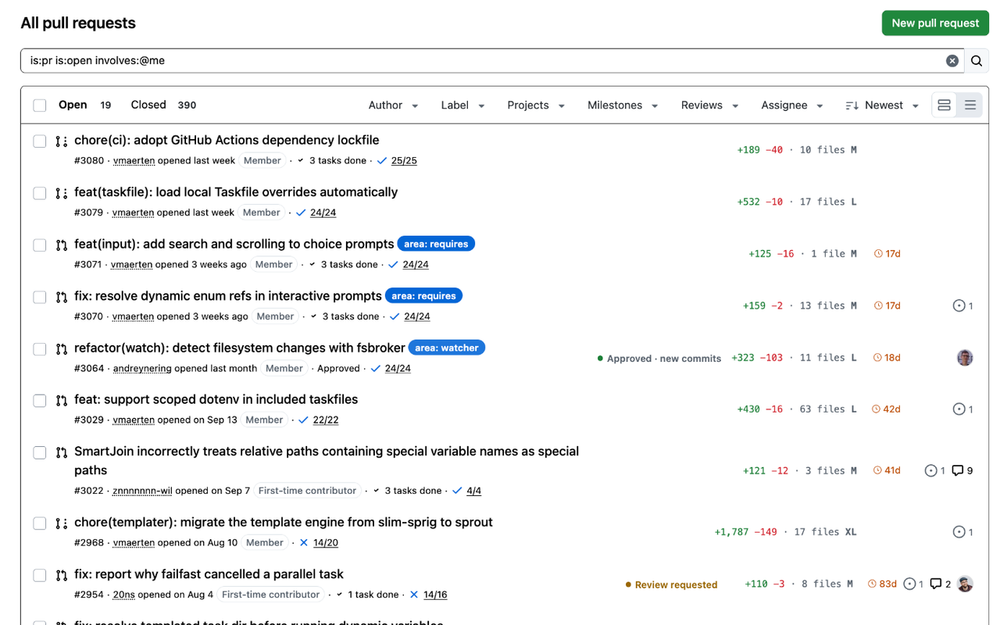

<h1 align="center">Polished GitHub</h1>

Polishes the GitHub you use every day, starting with pull requests. For Chrome and Firefox. <a href="https://polished-github.vmaerten.fr">Website</a> · <a href="https://polished-github.vmaerten.fr/features/">All features</a> · <a href="CHANGELOG.md">Changelog</a>

- **PR list**: where each PR stands for you, its size, and how long it has been idle.
- **Reviewers picker**: how many reviews each person already has waiting.
- **Quick comments**: your usual replies as one-click buttons.
- **Image modal**: images open in a zoomable modal instead of a new tab.

Every feature can be turned off in the options. The badges and the reviewer load need a read-only [fine-grained token](https://github.com/settings/personal-access-tokens/new?name=Polished+GitHub&description=Lets+the+Polished+GitHub+browser+extension+read+pull+requests&pull_requests=read) (_Pull requests_: read), kept on your device and sent only to the GitHub API.

## Install

From the [latest release](https://github.com/vmaerten/polished-github/releases/latest), load the Chrome zip, unzipped, as an unpacked extension (`chrome://extensions`, developer mode), or the Firefox zip as a temporary add-on (`about:debugging`).

## Contributing

See [CONTRIBUTING.md](CONTRIBUTING.md). [MIT](LICENSE) licensed. Not affiliated with, endorsed or sponsored by GitHub, Inc.
