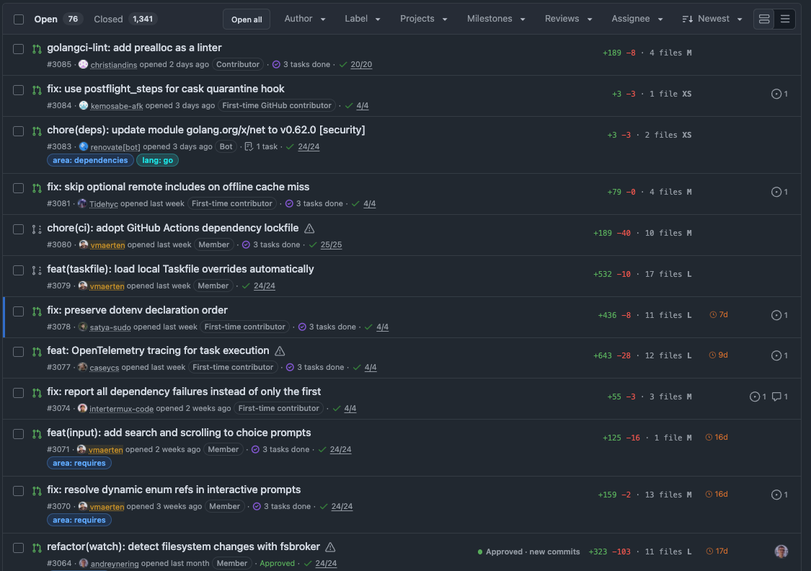
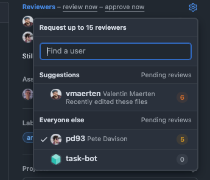
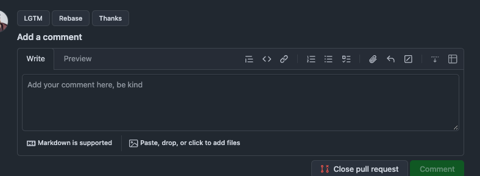
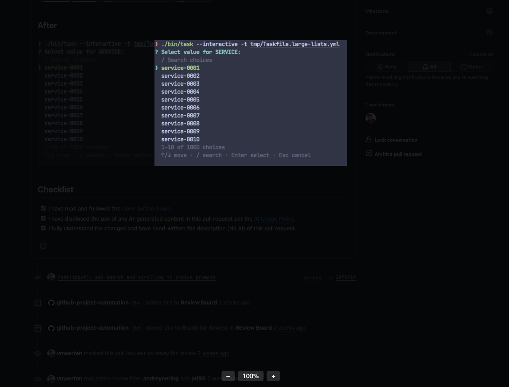

# Supercharged GitHub

Browser extension for Chrome and Firefox that makes reviewing pull requests on GitHub faster.

## Features

**In the PR list**, a column on the right of each PR: lines added and removed with a size label, where it stands for you (review requested, re-review, changes requested, approved but changed since) and how long it has been idle. The badges can go in the grey line under the title instead.



**In the reviewers picker**, how many reviews each person already has pending, to spread the load.



**Quick comments**: buttons above the comment box post a predefined comment in one click.



**Image modal**: images in issues, PRs and READMEs open in a zoomable modal instead of a new tab, and ← → go through the comment's images.



Every feature can be turned off, and most have settings, in the options page.

## Install

Download the zip of the [latest release](https://github.com/vmaerten/supercharged-github/releases/latest), unzip it, and load the folder as an unpacked extension (`chrome://extensions`, developer mode) or as a temporary add-on (`about:debugging` in Firefox).

The PR list badges and the reviewer load call the GitHub API: add a [fine-grained token](https://github.com/settings/personal-access-tokens/new) with read access to _Pull requests_ in the options, or a classic token with the `repo` scope. It stays on your device.

## Development

Needs [pnpm](https://pnpm.io) and [Task](https://taskfile.dev). `task` lists every command.

```sh
task install
task dev                  # rebuilds distribution/ on change
task start                # opens Chromium with the extension loaded; TARGET=firefox-desktop for Firefox
```

To use your everyday browser instead, load `distribution/` as an unpacked extension (`chrome://extensions`, developer mode) or as a temporary add-on (`about:debugging` in Firefox). In Firefox, grant the github.com permission from the extension's page in `about:addons`: Manifest V3 makes host permissions opt-in.

Before pushing: `task check`, which runs what CI runs. `task format` fixes formatting.

## Releasing

Every PR adds its user-facing changes under `## Unreleased` in `CHANGELOG.md`. To release, from an up-to-date `main`:

```sh
task release VERSION=1.2.0
```

It runs the checks, bumps `package.json` and `manifest.json`, dates the changelog section, commits, tags `v1.2.0` and pushes. The tag starts the release workflow, which builds the zip and publishes a GitHub release with that changelog section as notes.

## Layout

- `source/content-script.ts` starts the feature manager on every github.com page.
- `source/feature-manager.ts` runs each feature on matching pages, again after every in-app navigation, and skips features the user disabled or that need a missing token.
- `source/features/` holds one file per feature (a folder for bigger ones), registered in `features/index.ts`.
- `source/github-helpers/api.ts` calls the GitHub REST (`v3`) and GraphQL (`v4`) APIs with the user's token.
- `source/options/` is the options page (Svelte).

## Adding a feature

1. Create `source/features/<feature-id>.tsx` exporting a `Feature`: `id`, `description`, optional `include`/`exclude` page detectors from [`github-url-detection`](https://github.com/refined-github/github-url-detection), `requiresToken` if it calls the API, and `init(signal)`.
2. Add it to `source/features/index.ts`.

`init` runs again after each in-app navigation: check the element isn't already there before injecting, and pass `signal` to listeners and `element-ready` so they stop on the next navigation. Use [`dom-chef`](https://github.com/vadimdemedes/dom-chef) JSX for small injections, a Svelte component for anything stateful.
